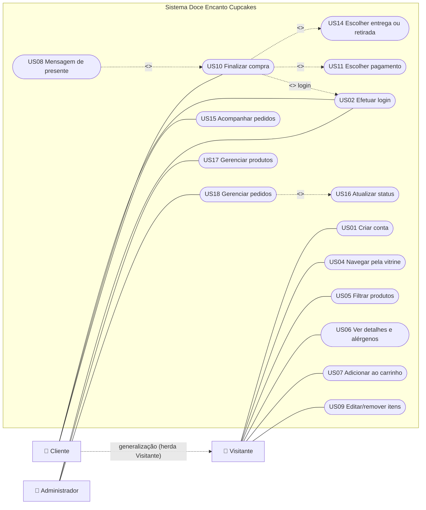
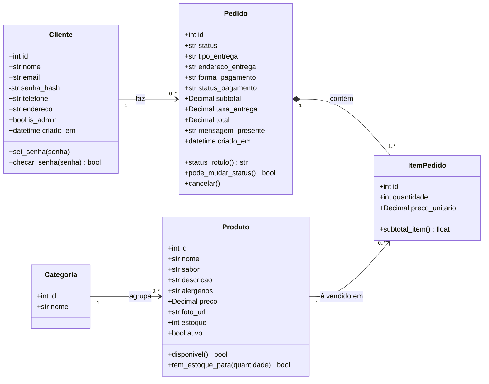
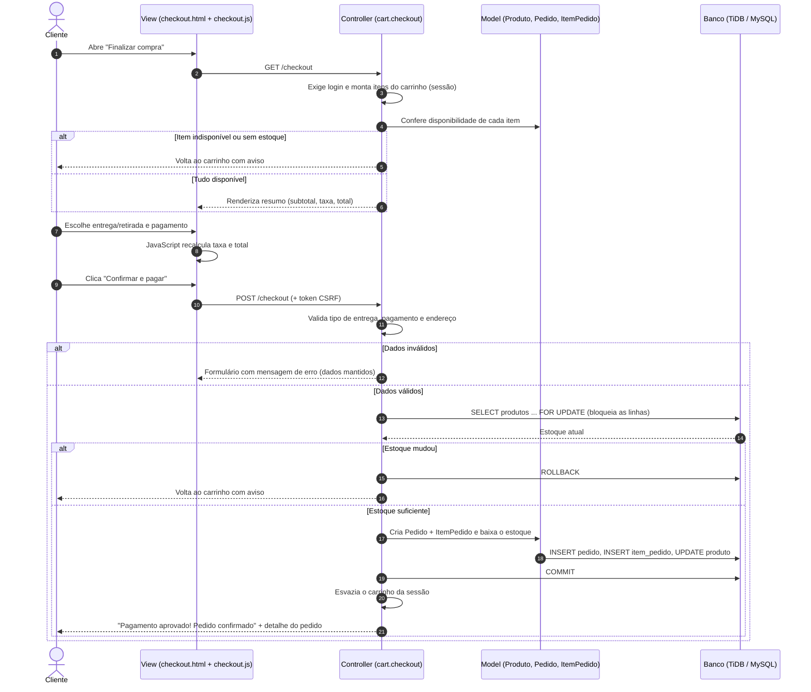
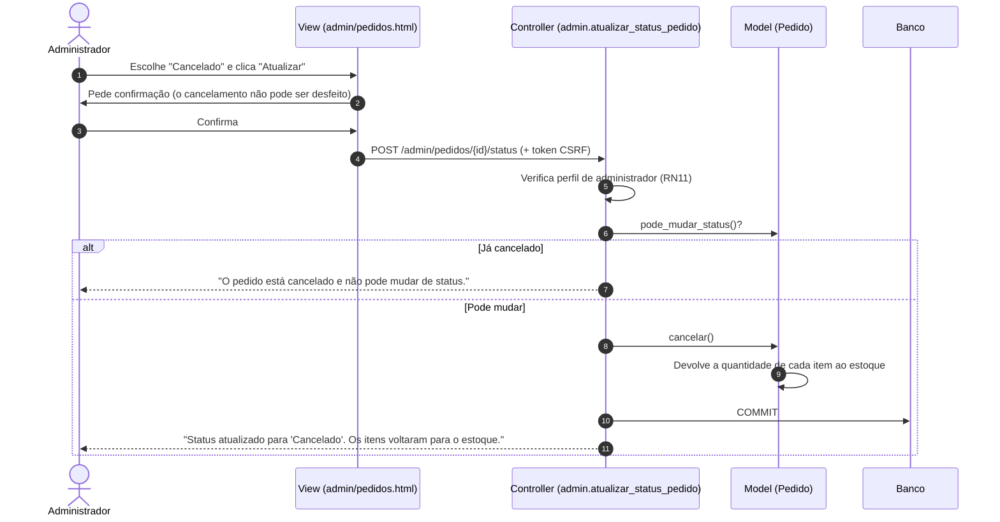
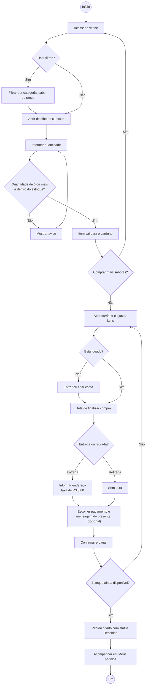
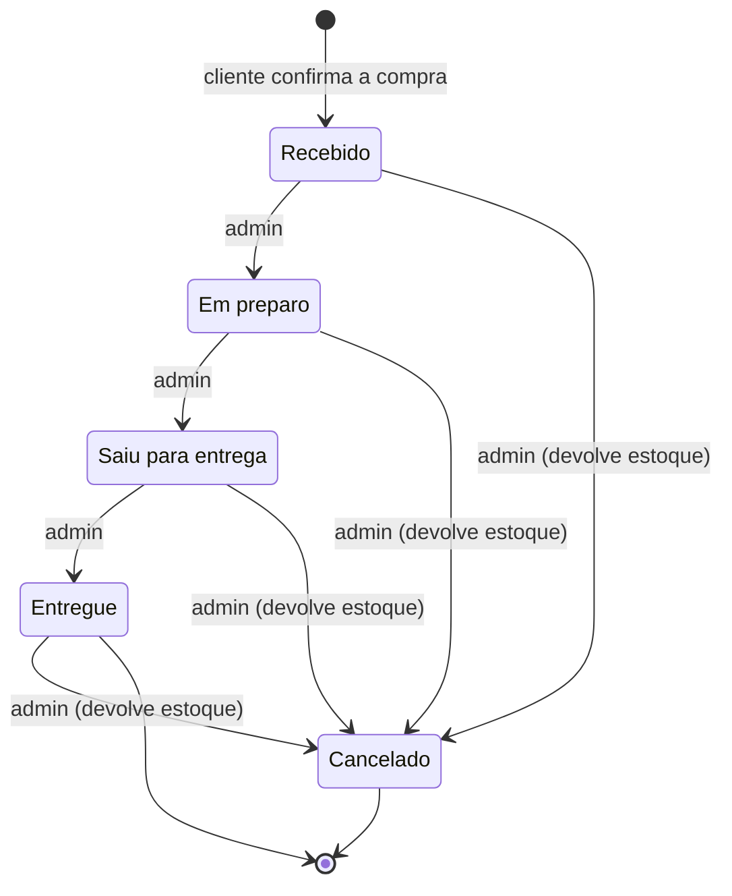

# 3. Diagramas UML

> Diagramas escritos em **Mermaid**: o GitHub os desenha automaticamente ao abrir este arquivo.
> Para exportar como imagem, cole cada bloco em <https://mermaid.live> e use "Download PNG".
> Todos foram feitos a partir do código atual (`app/models.py` e `app/routes/`).

## 3.1 Diagrama de casos de uso

O Mermaid não tem um tipo próprio para casos de uso; a notação abaixo segue a UML:
atores à esquerda/direita, casos de uso em elipses e relações `<<include>>`.
O **Cliente** herda tudo o que o **Visitante** faz (generalização).

## 3.2 Diagrama de classes (persistência)

Classes do Model (`app/models.py`). Atributos com tipo; métodos com as regras de negócio.

- **Composição** Pedido ◆— ItemPedido: o item não existe sem o pedido (no banco: `ON DELETE CASCADE`).
- **Associação** Produto — ItemPedido: o produto continua existindo mesmo que o pedido acabe; por isso a remoção de produto é lógica (`ativo = falso`).

## 3.3 Diagrama de sequência — Finalizar compra (US10, US11, US12, US14)

## 3.4 Diagrama de sequência — Administrador cancela um pedido (US18)

## 3.5 Diagrama de atividades — Jornada de compra do cliente

## 3.6 Diagrama de estados — Pedido

Complementa os demais: mostra as transições permitidas pela regra do sistema.
O administrador pode mudar livremente entre os estados ativos; **Cancelado é final**.

> Observação: o sistema também permite ao administrador **voltar** um pedido ativo para
> um status anterior (ex.: corrigir um clique errado). Só o estado Cancelado é definitivo.
