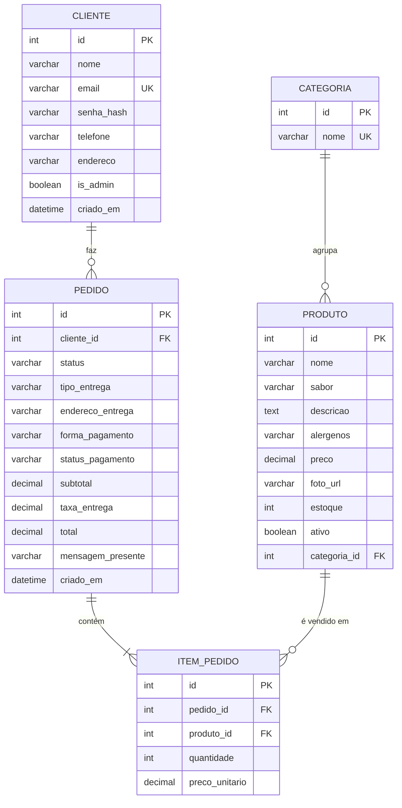

# 4. Projeto de dados: conceitual (DER), lógico e físico

> Situação-Problema 1: "Faça ou revise os projetos relacionados aos dados a partir do
> diagrama de classes de persistência (projeto conceitual, projeto lógico normalizado)" e
> "Execute o projeto físico do banco de dados".

## 4.1 Projeto conceitual — DER

### Cardinalidades

| Relacionamento | Cardinalidade | Leitura |
|---|---|---|
| CLIENTE — PEDIDO | 1 : 0..N | Um cliente faz zero ou muitos pedidos; cada pedido pertence a exatamente um cliente. |
| CATEGORIA — PRODUTO | 1 : 0..N | Uma categoria agrupa zero ou muitos produtos; todo produto tem uma categoria. |
| PEDIDO — ITEM_PEDIDO | 1 : 1..N | Um pedido tem pelo menos um item; o item só existe dentro do pedido. |
| PRODUTO — ITEM_PEDIDO | 1 : 0..N | Um produto aparece em zero ou muitos itens de pedido. |

O relacionamento **N:N entre PEDIDO e PRODUTO** é resolvido pela entidade associativa
**ITEM_PEDIDO**, que guarda os atributos do relacionamento (quantidade e preço no momento da compra).

## 4.2 Projeto lógico (modelo relacional)

Notação: **sublinhado = chave primária (PK)**, *itálico = chave estrangeira (FK)*.

- CLIENTE(<u>id</u>, nome, email, senha_hash, telefone, endereco, is_admin, criado_em)
  - email: UNIQUE
- CATEGORIA(<u>id</u>, nome)
  - nome: UNIQUE
- PRODUTO(<u>id</u>, nome, sabor, descricao, alergenos, preco, foto_url, estoque, ativo, *categoria_id*)
  - categoria_id → CATEGORIA(id)
- PEDIDO(<u>id</u>, *cliente_id*, status, tipo_entrega, endereco_entrega, forma_pagamento, status_pagamento, subtotal, taxa_entrega, total, mensagem_presente, criado_em)
  - cliente_id → CLIENTE(id)
- ITEM_PEDIDO(<u>id</u>, *pedido_id*, *produto_id*, quantidade, preco_unitario)
  - pedido_id → PEDIDO(id) ON DELETE CASCADE
  - produto_id → PRODUTO(id)

## 4.3 Análise de normalização

| Forma normal | Situação | Justificativa |
|---|---|---|
| **1FN** (valores atômicos) | Atendida, com uma ressalva | Todas as colunas têm um único valor. **Ressalva:** `produto.alergenos` guarda uma lista em texto ("glúten, ovo, lactose"). Foi uma decisão consciente: a lista só é exibida, nunca filtrada. Se for preciso filtrar por alérgeno, criar as tabelas `alergeno` e `produto_alergeno` (N:N). |
| **2FN** (sem dependência parcial) | Atendida | Todas as tabelas têm chave primária simples (`id`), então não existe dependência de parte da chave. |
| **3FN** (sem dependência transitiva) | Atendida, com redundâncias **intencionais** documentadas | Ver abaixo. |

**Redundâncias intencionais (desnormalização controlada):**

1. `item_pedido.preco_unitario` repete o preço do produto. **Não é redundância de fato:** é o
   preço *no momento da compra*. Se o admin mudar o preço depois, o histórico do pedido não muda.
2. `pedido.subtotal` e `pedido.total` poderiam ser calculados a partir dos itens. São gravados
   para que o valor cobrado fique registrado e não mude se algo for recalculado (auditoria).
3. `pedido.endereco_entrega` é separado de `cliente.endereco`: o cliente pode mandar um
   presente para outro endereço, e o histórico guarda para onde *aquele* pedido foi.

## 4.4 Projeto físico

O script físico completo está em [`schema.sql`](../../schema.sql) (MySQL 8 / TiDB Cloud):
tabelas `InnoDB`, charset `utf8mb4` (acentos e emojis), chaves estrangeiras, restrições
`CHECK` e índices.

### Índices criados

| Índice | Tabela (coluna) | Motivo |
|---|---|---|
| `idx_produto_categoria` | produto(categoria_id) | Filtro por categoria na vitrine |
| `idx_produto_ativo` | produto(ativo) | A vitrine só lista produtos ativos |
| `idx_pedido_cliente` | pedido(cliente_id) | Tela "Meus pedidos" |
| `idx_pedido_status` | pedido(status) | Filtro por status no painel do admin |
| `uq_cliente_email` | cliente(email) | Login por e-mail e bloqueio de duplicidade |
| `uq_categoria_nome` | categoria(nome) | Evita categorias repetidas |

### Integridade no TiDB Cloud (ponto de atenção)

No TiDB, a variável `tidb_enable_check_constraint` vem **desligada**: o banco aceita as
cláusulas `CHECK` do script, mas **não as aplica**. As chaves primárias, únicas e
estrangeiras continuam valendo. Por isso, **todas as regras de domínio são validadas na
aplicação**, que é a garantia efetiva:

| Restrição CHECK no `schema.sql` | Validação equivalente na aplicação |
|---|---|
| `ck_produto_preco` (preco >= 0) | `admin._ler_formulario_produto`: preço > 0 |
| `ck_produto_estoque` (estoque >= 0) | Formulário do admin + `Produto.tem_estoque_para` + checkout com `FOR UPDATE` |
| `ck_pedido_status` | `Pedido.STATUS` em `admin.atualizar_status_pedido` |
| `ck_pedido_tipo_entrega` | `Pedido.TIPOS_ENTREGA` em `cart.checkout` |
| `ck_pedido_status_pagamento` | Valor definido apenas pelo sistema |
| `ck_item_pedido_quantidade` (>= 6) | `QUANTIDADE_MINIMA_POR_SABOR` no carrinho |

Para conferir a conexão e esse parâmetro sem alterar nada: `python verificar_banco.py`.

### Mapeamento classe → tabela

| Classe (Model) | Tabela | Observação |
|---|---|---|
| `Cliente` | `cliente` | Herda `UserMixin` (Flask-Login) para autenticação |
| `Categoria` | `categoria` | |
| `Produto` | `produto` | |
| `Pedido` | `pedido` | Constantes de domínio (`STATUS`, `TIPOS_ENTREGA`, `FORMAS_PAGAMENTO`) ficam na classe |
| `ItemPedido` | `item_pedido` | Entidade associativa Pedido × Produto |
