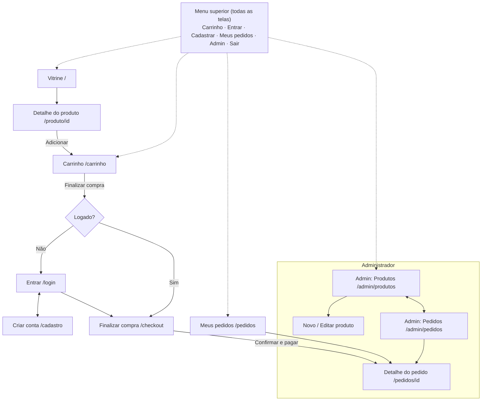

# 6. Interface (IHC): telas, navegação e mensagens

> Situação-Problema 1: "Verifique e adeque os elementos da IHC para poder refletir o que você
> pretende desenvolver em nível de telas, mensagens de erro, mapas conceituais [...]".
> As telas descritas aqui são as implementadas em `app/templates/`.

## 6.1 Mapa de navegação (arquitetura da informação)

## 6.2 Telas

| # | Tela | Endereço | Quem acessa | Elementos principais |
|---|---|---|---|---|
| T01 | Vitrine | `/` | Todos | Filtros (categoria, sabor, preço máximo, Limpar); cartões com foto, nome, sabor, preço e selo "Esgotado" |
| T02 | Detalhe do produto | `/produto/<id>` | Todos | Trilha "Vitrine > Produto"; foto; preço por unidade; descrição; alérgenos em destaque; estoque; campo de quantidade (mín. 6); "Adicionar ao carrinho" |
| T03 | Carrinho | `/carrinho` | Todos | Tabela com preço, quantidade editável, subtotal e "Remover"; itens com problema destacados em amarelo; "Continuar comprando"; "Finalizar compra" (desativado se houver problema) |
| T04 | Criar conta | `/cadastro` | Visitante | Nome, e-mail, senha (mín. 8) |
| T05 | Entrar | `/login` | Visitante | E-mail, senha; link para criar conta |
| T06 | Finalizar compra | `/checkout` | Cliente | Entrega/retirada (o endereço some na retirada); mensagem de presente; pagamento; resumo com total recalculado na hora; botão que se desativa ao enviar ("Processando pagamento...") |
| T07 | Meus pedidos | `/pedidos` | Cliente | Número, data (horário de Brasília), status colorido, total, "Ver detalhes" |
| T08 | Detalhe do pedido | `/pedidos/<id>` | Dono do pedido ou admin | Itens, status, entrega, endereço, pagamento, dedicatória e valores |
| T09 | Admin: Produtos | `/admin/produtos` | Admin | Tabela de produtos (ativos e inativos); "Editar"; "Remover" (com confirmação); "Novo produto"; atalho para pedidos |
| T10 | Novo/Editar produto | `/admin/produtos/novo` e `/<id>/editar` | Admin | Campos obrigatórios marcados com *; preço aceita vírgula; caixa "Ativo na vitrine"; ao errar, mantém o que foi digitado |
| T11 | Admin: Pedidos | `/admin/pedidos` | Admin | Filtro por status; tabela com cliente, data, entrega, total e status; troca de status (cancelamento pede confirmação); "Pedido encerrado" para cancelados |
| T12 | Página de erro | qualquer endereço inválido | Todos | Código (404/500), explicação e botão "Voltar para a vitrine" |

### Princípios de IHC aplicados (material teórico da disciplina)

| Princípio | Onde aparece |
|---|---|
| Clara | Rótulos em português simples; status legíveis ("Em preparo" em vez de `em_preparo`) |
| Consistente | Mesmo menu, cores e botão rosa em todas as telas; mensagens sempre no topo |
| Simples | Uma tarefa por tela; campos opcionais identificados |
| Controlada pelo usuário | Filtros com "Limpar"; "Continuar comprando"; cancelar formulário |
| Direta | Total muda na hora ao escolher retirada; selo "Esgotado" na vitrine |
| Recuperável / reversível | Confirmação antes de remover produto e de cancelar pedido; produto removido pode ser reativado; formulário com erro mantém os dados digitados |
| Dá resposta (feedback) | Mensagem para toda ação (tabela 6.3); botão "Processando pagamento..." |
| Esteticamente agradável | Paleta da marca, fotos, layout responsivo |
| Acessibilidade | Todos os campos com rótulo (`label`), textos alternativos nas imagens, menu operável pelo teclado |

## 6.3 Catálogo de mensagens

Cores: 🟢 sucesso · 🔵 informação · 🟡 aviso · 🔴 erro.

### Conta (US01, US02)
| Situação | Mensagem | Tipo |
|---|---|---|
| Campo obrigatório vazio no cadastro | Preencha todos os campos obrigatórios. | 🔴 |
| Nome muito longo | O nome pode ter no máximo 120 caracteres. | 🔴 |
| E-mail inválido | Informe um e-mail válido (ex.: nome@exemplo.com). | 🔴 |
| Senha curta | A senha deve ter no mínimo 8 caracteres. | 🔴 |
| E-mail já usado | Este e-mail já está cadastrado. | 🔴 |
| Cadastro concluído | Conta criada com sucesso! Faça login para continuar. | 🟢 |
| Login correto | Bem-vindo(a), *nome*! | 🟢 |
| Login incorreto | E-mail ou senha inválidos. | 🔴 |
| Página exige login | Faça login para continuar. | 🔵 |
| Sair | Você saiu da sua conta. | 🔵 |

### Carrinho (US07, US09)
| Situação | Mensagem | Tipo |
|---|---|---|
| Menos de 6 unidades | Quantidade mínima por sabor é 6 unidades. | 🟡 |
| Produto inativo/esgotado | Este produto não está disponível no momento. | 🟡 |
| Acima do estoque | Estoque insuficiente: temos *N* unidade(s) de *produto* e você já tem *M* no carrinho. | 🟡 |
| Item adicionado | *Produto* adicionado ao carrinho. | 🟢 |
| Quantidade alterada | Carrinho atualizado. | 🟢 |
| Item removido | Item removido do carrinho. | 🔵 |
| Alterar item que não está no carrinho | Este item não está no seu carrinho. | 🟡 |
| Produto saiu de linha | Este produto não está mais disponível. Remova-o do carrinho. | 🟡 |
| Destaque no item | ⚠ Produto indisponível no momento / ⚠ Estoque insuficiente (restam *N*) | selo 🟡 |

### Finalizar compra (US08, US10–US14)
| Situação | Mensagem | Tipo |
|---|---|---|
| Carrinho vazio | Seu carrinho está vazio. | 🟡 |
| Item com problema | Alguns itens do carrinho precisam de ajuste antes de finalizar a compra. | 🟡 |
| Entrega sem endereço | Informe o endereço de entrega ou escolha retirada na loja. | 🟡 |
| Endereço longo | O endereço pode ter no máximo 255 caracteres. | 🟡 |
| Valor inválido enviado | Escolha uma forma de entrega válida. / Escolha uma forma de pagamento válida. | 🟡 |
| Estoque mudou durante a compra | O estoque de um dos itens mudou enquanto você comprava. Confira o carrinho. | 🟡 |
| Falha ao gravar | Não foi possível concluir o pedido agora. Nenhum valor foi cobrado; tente novamente. | 🔴 |
| Sucesso | Pagamento aprovado! Pedido confirmado com sucesso. | 🟢 |

### Pedidos (US15)
| Situação | Mensagem | Tipo |
|---|---|---|
| Abrir pedido de outra pessoa | Você não tem permissão para ver este pedido. | 🔴 |

### Administração (US17, US18)
| Situação | Mensagem | Tipo |
|---|---|---|
| Não-admin tenta acessar | Acesso restrito ao administrador da loja. | 🔴 |
| Validações do produto | Informe o nome do produto. · Informe o sabor. · Informe um preço válido, maior que zero (ex.: 6,50). · O estoque deve ser um número inteiro igual ou maior que zero. · Informe a URL da foto (CA1: produto não pode ser publicado sem foto). · A URL da foto deve começar com http:// ou https:// (máx. 255 caracteres). · Escolha uma categoria válida. · (limites de tamanho de nome, sabor e alérgenos) | 🟡 |
| Produto salvo | Produto cadastrado com sucesso. / Produto atualizado com sucesso. | 🟢 |
| Produto removido | Produto removido da vitrine. | 🔵 |
| Confirmação (janela) | Remover este produto da vitrine? [...] / Cancelar o pedido #*N*? [...] | diálogo |
| Status alterado | Status do pedido #*N* atualizado para '*Status*'. (+ "Os itens voltaram para o estoque." ao cancelar) | 🟢 |
| Mesmo status | O pedido #*N* já está como '*Status*'. | 🔵 |
| Pedido cancelado | O pedido #*N* está cancelado e não pode mudar de status. | 🟡 |
| Status inexistente | Status inválido. | 🔴 |

### Gerais
| Situação | Mensagem | Tipo |
|---|---|---|
| Formulário expirado (CSRF) | Sua sessão expirou ou o formulário ficou desatualizado. Tente novamente. | 🟡 |
| Endereço inexistente (404) | Página não encontrada: o endereço acessado não existe ou o item foi removido. | página |
| Erro inesperado (500) | Algo deu errado: tivemos um problema ao processar sua solicitação. | página |
